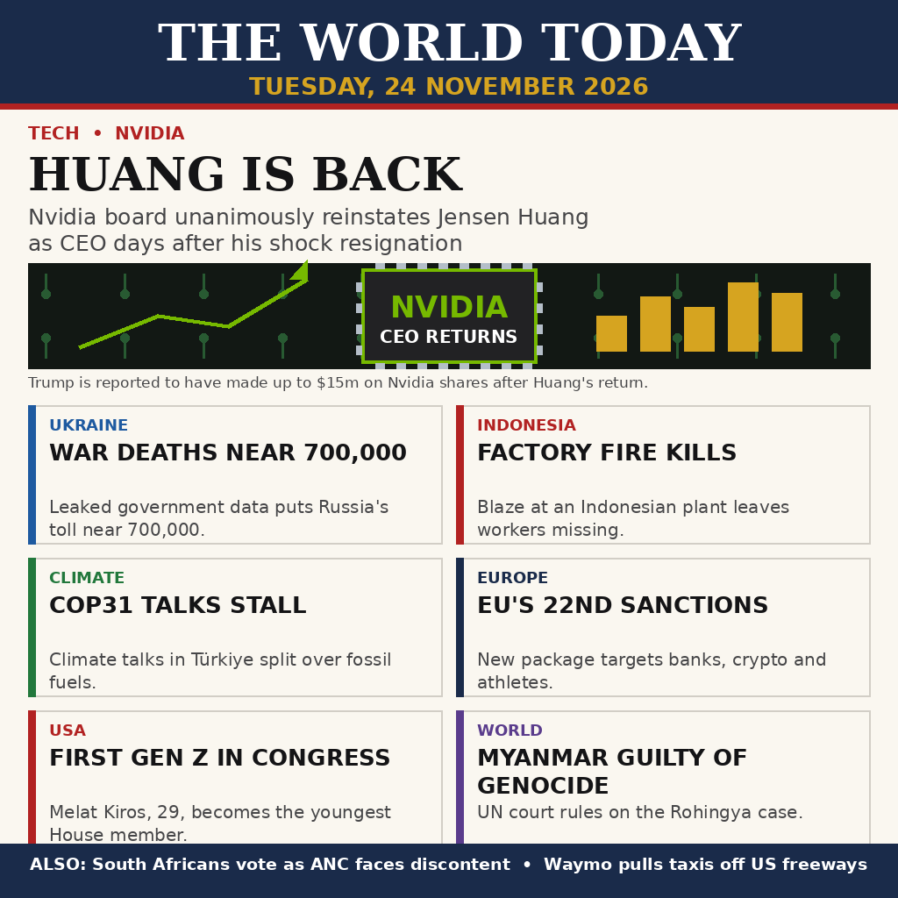

# The World Today — Tuesday, 24 November 2026

[](https://make.fun/bounty/news-image-20261124?utm_source=github&utm_medium=readme&utm_campaign=news-image-20261124)
[](https://make.fun/bounty/news-image-20261124/leaderboard?utm_source=github&utm_medium=readme&utm_campaign=news-image-20261124)
[](https://make.fun/bounty/news-image-20261124?utm_source=github&utm_medium=readme&utm_campaign=news-image-20261124)

Entry for make.fun's **news-image-20261124** bounty: sum up the world's news of
Tuesday 24 November 2026 in one image, $100 in USDC shared by the top 50.

## The image



A newspaper front page drawn with PIL for crisp, legible text:

- **Lead:** Nvidia's board unanimously reinstates Jensen Huang as CEO days
  after his shock resignation; Trump is reported to have made up to $15m on
  Nvidia shares after Huang's return.
- **Ukraine:** leaked government data puts Russia's war death toll near 700,000.
- **Indonesia:** a factory fire leaves workers missing.
- **Climate:** COP31 talks in Türkiye stall, split over fossil fuels.
- **Europe:** the EU proposes a 22nd sanctions package against Russia.
- **USA:** Melat Kiros, 29, becomes the first Gen Z woman to enter Congress.
- **World:** the UN's top court rules Myanmar committed genocide against the Rohingya.
- **Also:** South Africans vote as discontent threatens the ANC; Waymo pulls
  its driverless taxis off US freeways.

## The program

`main.py` (Python 3.13, standard library only) validates that `entry.png` is
a real PNG and copies it to `$MAKEFUN_OUTPUT_DIR/entry.png` (default
`/output`). It runs with no network and writes identical bytes every run.

Run it locally:

```
mkdir -p out && MAKEFUN_OUTPUT_DIR=out python3 main.py
```
